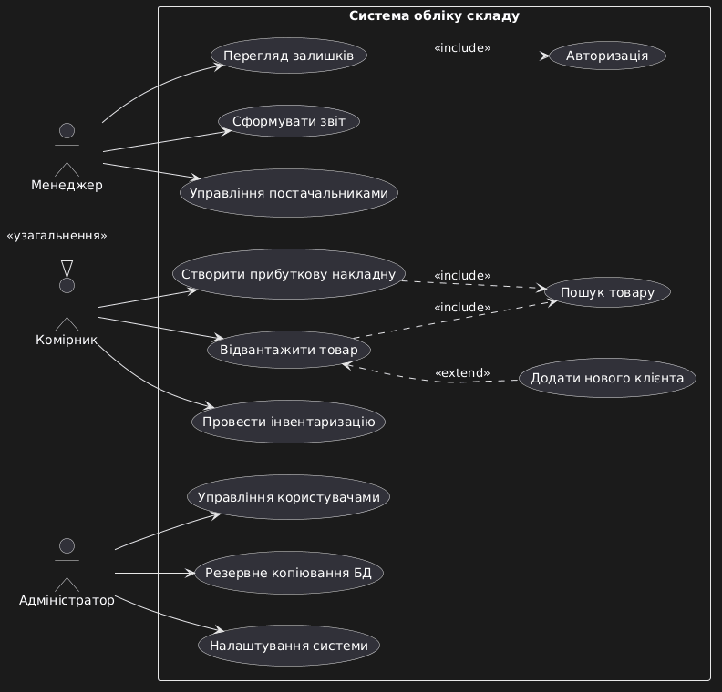
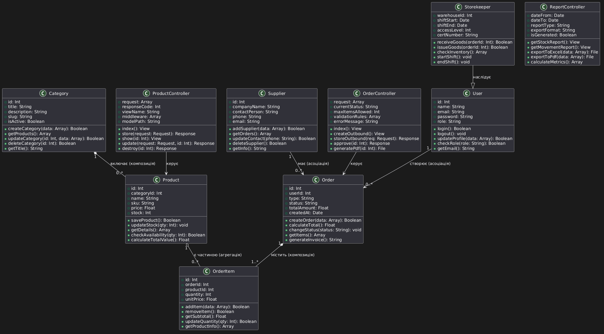

# Архітектура Системи обліку товарів на складі

## Характеристика системи та предметної галузі
**Призначення:** Автоматизація складського обліку, відслідковування залишків, контроль приймання та відвантаження товарів.
**Основні сутності:** Користувач, Товар, Категорія, Замовлення, Елемент замовлення, Постачальник.
**Архітектура:** Побудована за патерном MVC (Model-View-Controller).

## Головний Use Case (Повна форма): Відвантаження товару
Комірник авторизується в системі та створює нову видаткову накладну. Він обирає клієнта зі списку та шукає товар за артикулом. Після введення необхідної кількості для відвантаження, система перевіряє наявність товару на складі. Після натискання "Провести накладну", система автоматично списує вказані товари із залишків та генерує документ для друку.

## Діаграма варіантів використання

## Діаграма класів
